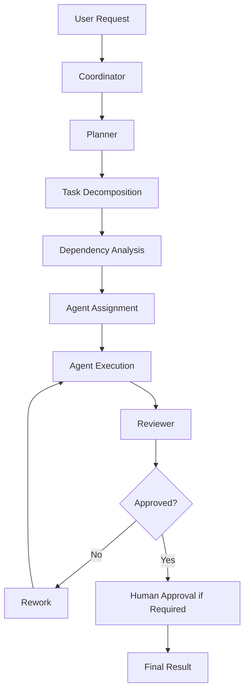
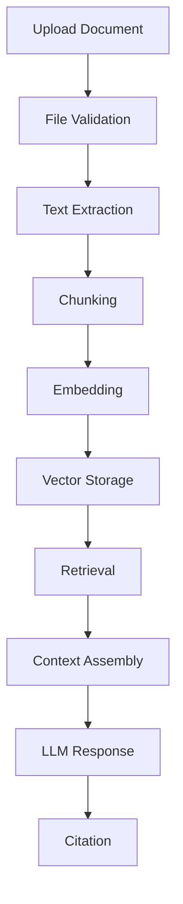

# NEXORA AI
## Enterprise AI Workforce & Workflow Intelligence Platform

**Product Specification – Full Feature & Technical Requirements**

| Thông tin | Giá trị |
|---|---|
| Product Name | NEXORA AI |
| Version | 2.0 |
| Product Type | Enterprise AI Workforce Platform |
| Development Strategy | Extend Existing Project |
| Existing Foundation | AI Knowledge Hub |
| AI Orchestration | LangGraph (nếu phù hợp với kiến trúc hiện tại) |
| Automation | n8n |
| LLM Provider | Claude API và các provider hiện có |
| Target Users | Doanh nghiệp, Developer, Team Leader, AI Operator |

---

# PART 1. MANDATORY DEVELOPMENT RULES

## 1.1. Existing Project – Bắt buộc sử dụng source code hiện tại

Đường dẫn dự án:

```text
F:\Clone\clone-digotal_3\AI_Application\AI_Knowledge_Hub_Intelligent_Document_Assistant
```

**Đây là project duy nhất được phép sử dụng để phát triển NEXORA AI.**

NEXORA AI là phiên bản mở rộng của AI Knowledge Hub hiện tại, không phải một dự án mới.

### Những điều tuyệt đối không được thực hiện

- Không tạo project mới.
- Không tạo một frontend mới độc lập.
- Không tạo một backend mới độc lập.
- Không viết lại toàn bộ hệ thống.
- Không đổi ngôn ngữ lập trình.
- Không đổi framework frontend.
- Không đổi framework backend.
- Không đổi database.
- Không tự ý chuyển MongoDB sang PostgreSQL hoặc database khác.
- Không tự ý chuyển FastAPI sang NestJS hoặc framework khác.
- Không tự ý thay thế các module đang hoạt động.
- Không xóa chức năng hiện tại.
- Không tạo mock frontend thay cho dữ liệu backend.
- Không tự ý thay đổi cấu trúc thư mục lớn khi chưa có lý do kỹ thuật.

Các công nghệ được nhắc đến trong tài liệu này chỉ là định hướng tích hợp. Phải kiểm tra source code trước khi quyết định sử dụng.

### Quy trình bắt buộc

Trước khi viết code:

1. Đọc cấu trúc thư mục.
2. Đọc README và ARCHITECTURE.
3. Kiểm tra frontend.
4. Kiểm tra backend.
5. Kiểm tra database.
6. Kiểm tra authentication.
7. Kiểm tra AI provider.
8. Kiểm tra Agent execution.
9. Kiểm tra Knowledge Hub và RAG.
10. Kiểm tra streaming.
11. Kiểm tra n8n.
12. Kiểm tra Docker và environment variables.

Sau đó tạo báo cáo:

- Current Architecture.
- Existing Features.
- Reusable Modules.
- Missing Features.
- Database Impact.
- API Impact.
- Security Risks.
- Implementation Roadmap.

Chỉ bắt đầu thay đổi code sau khi hoàn thành audit.

---

# PART 2. PRODUCT VISION

## 2.1. Product Overview

NEXORA AI là nền tảng giúp doanh nghiệp quản lý và điều phối lực lượng AI Agent phối hợp với con người để xử lý công việc thực tế.

Hệ thống không đơn thuần là một AI chatbot hoặc một website có nhiều AI cùng trả lời.

NEXORA AI cung cấp một môi trường làm việc thống nhất, trong đó:

- Con người giao việc cho AI.
- AI phân tích và chia nhỏ nhiệm vụ.
- Các Agent chuyên môn nhận nhiệm vụ phù hợp.
- Các Agent trao đổi thông tin và phối hợp.
- n8n thực hiện các quy trình tự động hóa.
- Knowledge Hub cung cấp kiến thức doanh nghiệp.
- Reviewer kiểm tra chất lượng kết quả.
- Human Approval kiểm soát các hành động quan trọng.
- Evaluation đánh giá hiệu suất AI.
- Observability theo dõi toàn bộ quá trình.

## 2.2. Core Value

NEXORA phải giải quyết được câu hỏi:

**Làm thế nào để doanh nghiệp giao việc cho AI, cho phép AI phối hợp thực hiện, nhưng vẫn kiểm soát được chất lượng, chi phí, quyền hạn và trách nhiệm?**

## 2.3. Product Principles

1. AI hỗ trợ con người, không tự ý thay thế mọi quyết định.
2. Mọi nhiệm vụ đều phải có trạng thái.
3. Mọi hành động quan trọng đều phải có quyền kiểm soát.
4. Mọi lần thực thi đều phải có lịch sử.
5. AI phải sử dụng kiến thức được cấp quyền.
6. Kết quả phải được đánh giá.
7. Workflow phải có khả năng xử lý lỗi.
8. Dữ liệu phải được lưu trong database thực tế.
9. Không giả lập thành công cho những chức năng chưa được tích hợp.
10. Người dùng phải có khả năng can thiệp và dừng quá trình.

---

# PART 3. USER ROLES & PERMISSIONS

## 3.1. Roles

| Role | Quyền |
|---|---|
| Super Admin | Quản lý toàn hệ thống |
| Workspace Owner | Quản lý workspace |
| Admin | Quản lý thành viên và cấu hình |
| Team Leader | Quản lý Agent Team và nhiệm vụ |
| Employee | Giao việc và theo dõi kết quả |
| AI Operator | Theo dõi hoạt động của Agent |
| Viewer | Chỉ xem dữ liệu được cấp quyền |

## 3.2. Permission Management

Phải kiểm soát quyền đối với:

- Workspace.
- Conversation.
- Agent.
- Agent Team.
- Task.
- Workflow.
- Knowledge Document.
- Approval.
- Evaluation.
- API Credentials.
- Audit Logs.

Mọi API phải kiểm tra quyền ở backend.

Không dựa vào việc ẩn nút trên frontend để bảo vệ dữ liệu.

---

# PART 4. COMPLETE PRODUCT MODULES

# MODULE 01 – Executive Dashboard

## Mục tiêu

Cung cấp cái nhìn tổng quan về hoạt động AI trong doanh nghiệp.

## Features

### Overview Cards

- Total Workspaces.
- Total AI Agents.
- Active Agents.
- Total Tasks.
- Completed Tasks.
- Failed Tasks.
- Pending Approvals.
- Active Workflows.
- Total LLM Tokens.
- Estimated LLM Cost.

### Analytics

- Task completion rate.
- Task failure rate.
- Agent utilization.
- Workflow success rate.
- Average task duration.
- LLM cost over time.
- Token consumption.
- Model usage distribution.

### Recent Activity

Hiển thị:

- Agent vừa hoạt động.
- Task vừa hoàn thành.
- Workflow vừa chạy.
- Approval mới.
- Execution thất bại.
- Người dùng vừa tạo workspace.

### Quick Actions

- Create Workspace.
- Create Agent.
- Start Conversation.
- Create Task.
- Run Workflow.
- Upload Document.

### Requirements

Tất cả thống kê phải được tính từ dữ liệu thực tế.

Nếu sử dụng dữ liệu demo, phải nhận diện rõ dữ liệu demo.

Không hiển thị số liệu giả như số liệu production.

---

# MODULE 02 – Workspace Management

## Mục tiêu

Tạo môi trường làm việc riêng cho từng nhóm hoặc phòng ban.

## Features

- Create Workspace.
- Edit Workspace.
- Delete Workspace với xác nhận và kiểm tra phụ thuộc.
- Workspace Description.
- Workspace Avatar.
- Workspace Members.
- Workspace Roles.
- Workspace Settings.
- Workspace AI Configuration.
- Workspace Model Configuration.
- Workspace Knowledge Base.
- Workspace Agent Teams.
- Workspace Workflow Access.
- Workspace Usage Limits.

### Workspace Dashboard

Mỗi workspace có:

- Overview.
- Conversations.
- Agents.
- Teams.
- Tasks.
- Workflows.
- Knowledge.
- Evaluations.
- Approvals.
- Activity Logs.
- Settings.

### Data Isolation

Người dùng chỉ được truy cập dữ liệu của workspace mà họ có quyền.

---

# MODULE 03 – AI Collaboration Workspace

## Mục tiêu

Đây là giao diện trung tâm của NEXORA.

Cho phép con người và nhiều AI Agent làm việc trong cùng một không gian.

## 3.1. Layout

### Left Sidebar

- Workspace Switcher.
- Recent Conversations.
- Pinned Conversations.
- Agent Teams.
- Direct Agent Chat.
- Task Board.
- Workflow Center.
- Knowledge Hub.
- Settings.

### Main Chat Area

- Conversation Header.
- Member Avatars.
- Online/Working Status.
- Message History.
- Message Composer.
- Agent Activity.
- Task Assignment Notifications.
- Execution Timeline.
- Final Reports.

### Right Sidebar

- Active Agents.
- Agent Roles.
- Current Tasks.
- Task Progress.
- Execution Status.
- Token Usage.
- Estimated Cost.
- Context Information.

## 3.2. Chat Features

- Create Conversation.
- Rename Conversation.
- Delete Conversation.
- Archive Conversation.
- Pin Conversation.
- Search Conversation.
- Search Messages.
- Reply to Message.
- Edit Own Message.
- Delete Own Message.
- Copy Message.
- Markdown Rendering.
- Code Highlighting.
- File Attachments.
- Image Attachments.
- Document Attachments.
- Message Reactions.
- @Mention Agent.
- @Mention Member.
- Message Thread.
- Conversation Export.

## 3.3. AI-to-AI Communication

Cho phép các Agent trao đổi thông tin trong phòng làm việc.

Ví dụ:

```text
User:
Phân tích lỗi đăng nhập của hệ thống.

Coordinator:
Tôi sẽ chia nhiệm vụ cho Researcher, Developer và Reviewer.

Planner:
Tạo 3 nhiệm vụ:
- Nghiên cứu luồng đăng nhập.
- Phân tích nguyên nhân lỗi.
- Kiểm tra đề xuất sửa lỗi.

Researcher:
Tôi đã tìm được các tài liệu liên quan.

Developer:
Tôi đã phân tích các file liên quan và có đề xuất.

Reviewer:
Tôi đã kiểm tra phương án và phát hiện một rủi ro.

Coordinator:
Đây là báo cáo tổng hợp.
```

### Communication Features

- Agent Message.
- Agent Handoff.
- Agent Collaboration.
- Agent Discussion.
- Agent Review Request.
- Agent Response.
- Agent Status.
- Agent Activity Timeline.
- Agent-to-Task Linking.
- Message Context.
- Shared Context.
- Task Context.

Không cho phép Agent trao đổi vô hạn.

Mỗi cuộc trao đổi phải có mục đích, giới hạn lượt, timeout và ngân sách token.

Không hiển thị private chain-of-thought. Chỉ hiển thị nội dung giao việc, tóm tắt công việc, kết quả và các hoạt động được phép công khai.

## 3.4. Message Composer

- Text Input.
- Attach File.
- Select Agent.
- Select Agent Team.
- Enable Knowledge Context.
- Enable Workflow.
- Model Selection nếu được cấp quyền.
- Execution Mode.
- Send Message.
- Stop Generation.

## 3.5. Execution Modes

**Single Agent**

Gửi yêu cầu cho một Agent.

**Multi-Agent**

Coordinator phân công cho nhiều Agent.

**Parallel Execution**

Nhiều Agent thực hiện các nhiệm vụ độc lập cùng lúc.

**Sequential Execution**

Agent thực hiện theo thứ tự phụ thuộc.

**Human-in-the-loop**

Tạm dừng để chờ người dùng đưa ra quyết định.

---

# MODULE 04 – AI Agent Management

## Mục tiêu

Quản lý các Agent như những nhân sự chuyên môn trong hệ thống.

## Features

- Create Agent.
- Edit Agent.
- Duplicate Agent.
- Activate/Deactivate.
- Delete Agent.
- Agent Profile.
- Agent Instructions.
- Agent Model.
- Agent Provider.
- Agent Tools.
- Agent Permissions.
- Agent Knowledge Access.
- Agent Token Limits.
- Agent Cost Limits.
- Agent Timeout.
- Agent Execution History.
- Agent Performance.
- Agent Health Status.

## Agent Configuration

Mỗi Agent có:

```text
Agent ID
Name
Description
Role
System Instructions
Model Provider
Model Name
Temperature
Max Tokens
Tools
Permissions
Knowledge Sources
Timeout
Retry Policy
Budget
Status
Created At
Updated At
```

Không để Agent tự ý truy cập toàn bộ tools.

Mỗi Agent phải có danh sách tools được cấp quyền.

## Initial Agent Team

### 1. Coordinator Agent

Vai trò: Điều phối.

- Tiếp nhận yêu cầu.
- Phân tích mục tiêu.
- Chọn Agent phù hợp.
- Phân phối nhiệm vụ.
- Theo dõi tiến độ.
- Tổng hợp kết quả.

### 2. Planner Agent

Vai trò: Lập kế hoạch.

- Chia nhỏ yêu cầu.
- Xác định thứ tự.
- Xác định phụ thuộc.
- Xác định Agent phù hợp.
- Ước tính độ phức tạp.

### 3. Researcher Agent

Vai trò: Nghiên cứu.

- Thu thập thông tin.
- Tìm kiếm tài liệu.
- Truy xuất Knowledge Hub.
- Tổng hợp nguồn.
- Báo cáo kết quả.

### 4. Knowledge Analyst Agent

Vai trò: Phân tích kiến thức doanh nghiệp.

- Tìm kiếm tài liệu.
- Semantic Search.
- Phân tích nội dung.
- Trích xuất dữ liệu.
- Trả lời có nguồn tham chiếu.

### 5. Developer Agent

Vai trò: Phân tích kỹ thuật.

- Phân tích code.
- Phân tích lỗi.
- Đề xuất phương án.
- Viết code nếu được cấp quyền.
- Phân tích rủi ro kỹ thuật.

### 6. Reviewer Agent

Vai trò: Kiểm tra.

- Review kết quả.
- Kiểm tra logic.
- Kiểm tra tính đầy đủ.
- Phát hiện rủi ro.
- Đưa ra yêu cầu chỉnh sửa.

### 7. Evaluator Agent

Vai trò: Đánh giá.

- Đánh giá đầu ra.
- Kiểm tra cấu trúc.
- Đánh giá độ chính xác.
- Tính điểm theo tiêu chí.
- Ghi nhận kết quả đánh giá.

Chỉ triển khai các Agent thực sự cần thiết cho từng nghiệp vụ.

---

# MODULE 05 – Agent Team Management

## Features

- Create Team.
- Edit Team.
- Delete Team.
- Add Agent.
- Remove Agent.
- Set Team Leader.
- Set Coordinator.
- Configure Team Instructions.
- Configure Shared Knowledge.
- Configure Team Budget.
- Configure Execution Strategy.
- Configure Team Permissions.
- Team Performance.

## Team Examples

### Engineering Team

- Coordinator.
- Planner.
- Developer.
- Reviewer.

### Research Team

- Coordinator.
- Researcher.
- Knowledge Analyst.
- Evaluator.

### Business Operations Team

- Coordinator.
- Planner.
- Researcher.
- Workflow Agent.

Cho phép tạo Team tùy chỉnh.

---

# MODULE 06 – AI Task Management

## Mục tiêu

Quản lý nhiệm vụ được giao cho AI và con người.

## Features

- Create Task.
- Assign Task.
- Reassign Task.
- Edit Task.
- Delete Task theo quyền.
- Task Priority.
- Task Deadline.
- Task Description.
- Task Dependencies.
- Task Subtasks.
- Task Comments.
- Task Attachments.
- Task Labels.
- Task History.
- Task Retry.
- Task Cancel.
- Task Review.
- Task Approval.

## Task Status

```text
pending
assigned
in_progress
waiting_for_input
waiting_for_approval
under_review
completed
failed
cancelled
```

## Task Board

Hiển thị dạng Kanban:

- Backlog.
- Pending.
- In Progress.
- Review.
- Approval.
- Completed.
- Failed.

Cho phép lọc theo:

- Agent.
- Team.
- Workspace.
- Priority.
- Status.
- Date.
- Task Type.

## Task Detail

Hiển thị:

- Task Information.
- Assigned Agent.
- Parent Task.
- Subtasks.
- Dependencies.
- Execution Timeline.
- Agent Messages.
- Results.
- Review Comments.
- Approval Status.
- Token Usage.
- Estimated Cost.

---

# MODULE 07 – AI Orchestration Engine

## Mục tiêu

Điều phối toàn bộ quá trình phối hợp giữa các Agent.

## Features

- Request Analysis.
- Task Decomposition.
- Agent Selection.
- Task Assignment.
- Agent Handoff.
- Sequential Execution.
- Parallel Execution.
- Conditional Routing.
- Result Aggregation.
- Review Loop.
- Retry.
- Timeout.
- Execution Cancellation.
- Execution Resume.
- State Persistence.
- Error Recovery.

## Orchestration Flow



## Technical Rules

- Backend quản lý trạng thái chính.
- LangGraph quản lý luồng điều phối và trạng thái Agent nếu phù hợp.
- Không tạo vòng lặp Agent vô hạn.
- Có giới hạn số lượt handoff.
- Có giới hạn token và chi phí.
- Có timeout.
- Có checkpoint.
- Có execution ID.
- Có correlation ID.
- Có retry policy.
- Có cancellation.

---

# MODULE 08 – Enterprise Knowledge Hub

## Mục tiêu

Tái sử dụng AI Knowledge Hub hiện tại làm nền tảng kiến thức doanh nghiệp.

Không viết lại RAG nếu đã hoạt động.

## Features

### Document Management

- Upload Document.
- Delete Document theo quyền.
- Rename Document.
- Preview Document.
- Download Document.
- Search Document.
- Document Categories.
- Document Tags.
- Document Metadata.
- Document Version.
- Document Status.
- Document Ownership.

### Supported File Types

Ưu tiên kiểm tra khả năng hỗ trợ hiện có đối với:

- PDF.
- DOCX.
- TXT.
- Markdown.
- CSV.
- XLSX.
- PPTX.

Không cam kết hỗ trợ định dạng chưa có parser.

### RAG Pipeline



### Advanced Features

- Semantic Search.
- Hybrid Search nếu phù hợp.
- Metadata Filtering.
- Reranking nếu cần.
- Source Citations.
- Retrieval History.
- Document Processing Status.
- Access Control.
- Knowledge Base Management.

### Agent Integration

Agent phải được cấp quyền truy cập Knowledge Base cụ thể.

Không cho phép Agent đọc toàn bộ tài liệu doanh nghiệp mặc định.

---

# MODULE 09 – Workflow Automation Center

## Mục tiêu

Kết nối AI với các hệ thống và quy trình doanh nghiệp thông qua n8n.

## Features

- Workflow List.
- Workflow Detail.
- Workflow Status.
- Workflow Execution History.
- Trigger Workflow.
- Workflow Logs.
- Workflow Retry.
- Workflow Cancel nếu integration hỗ trợ.
- Workflow Error Tracking.
- Workflow Configuration.
- Webhook Management.
- Integration Credentials.
- Workflow Analytics.

## Workflow Categories

### A. Task Automation

- Task Intake.
- Task Assignment.
- Task Completion.
- Task Escalation.
- Deadline Notification.

### B. GitHub Automation

- New Issue Trigger.
- Issue Analysis.
- Pull Request Analysis.
- Commit Analysis.
- Code Review Notification.
- Release Notification.

### C. GitLab Automation

- Issue Trigger.
- Merge Request Trigger.
- Pipeline Status.
- Build Failure Notification.
- Deployment Notification.

### D. Document Automation

- Document Upload.
- Document Processing.
- Knowledge Indexing.
- Document Review.
- Knowledge Update Notification.

### E. Approval Automation

- Approval Request.
- Approval Notification.
- Approval Response.
- Rejection Handling.
- Workflow Resume.

### F. Monitoring Automation

- Execution Failure Detection.
- Retry.
- Error Notification.
- Daily Report.
- Weekly Usage Report.

## Initial n8n Workflows

Bắt đầu với các workflow có thể demo end-to-end:

| ID | Workflow | Mục đích |
|---|---|---|
| WF01 | Document Ingestion | Xử lý tài liệu mới |
| WF02 | Task Intake | Tiếp nhận công việc |
| WF03 | Agent Dispatch | Gửi yêu cầu đến Backend Orchestrator |
| WF04 | GitHub Issue Analysis | Phân tích GitHub issue |
| WF05 | Approval Notification | Thông báo phê duyệt |
| WF06 | Workflow Recovery | Xử lý lỗi workflow |
| WF07 | Task Completion | Thông báo hoàn thành |
| WF08 | Scheduled Evaluation | Chạy đánh giá định kỳ |
| WF09 | Usage Reporting | Báo cáo chi phí và token |
| WF10 | GitLab Pipeline Monitoring | Theo dõi pipeline |

Chỉ đánh dấu workflow là Active khi đã kết nối và chạy thành công.

Không tạo workflow giả chỉ để tăng số lượng.

## n8n Integration Rules

- Webhook phải được xác thực.
- Có timeout.
- Có retry có giới hạn.
- Có idempotency.
- Có execution ID.
- Có log.
- Không lưu API key dạng plaintext.
- Không để n8n tự ý thay đổi dữ liệu quan trọng ngoài quyền được cấp.

---

# MODULE 10 – Human Approval Center

## Mục tiêu

Đảm bảo con người kiểm soát các hành động có ảnh hưởng đến hệ thống thật.

## Features

- Approval Inbox.
- Approval Detail.
- Approve.
- Reject.
- Request Changes.
- Approval Comments.
- Approval History.
- Approval Deadline.
- Approval Notification.
- Approval Policy.

## Actions Requiring Approval

- Gửi email ra bên ngoài.
- Tạo hoặc đóng GitHub Issue.
- Merge Pull Request.
- Thay đổi dữ liệu khách hàng.
- Cập nhật dữ liệu quan trọng.
- Thực hiện hành động trên hệ thống production.
- Chạy workflow có tác động đến hệ thống thật.

Không yêu cầu phê duyệt đối với mọi hành động đọc dữ liệu hoặc phân tích thông thường.

---

# MODULE 11 – LLM Evaluation Center

## Mục tiêu

Đánh giá chất lượng AI thay vì chỉ theo dõi việc AI có phản hồi hay không.

## Features

- Evaluation Dataset.
- Test Case Management.
- Evaluation Runs.
- Model Comparison.
- Prompt Comparison.
- Agent Comparison.
- Regression Testing.
- Evaluation Reports.
- Evaluation History.
- Scorecards.

## Metrics

| Metric | Ý nghĩa |
|---|---|
| Accuracy | Độ chính xác |
| Task Success Rate | Tỷ lệ hoàn thành |
| Latency | Độ trễ |
| Token Usage | Lượng token |
| Estimated Cost | Chi phí ước tính |
| Citation Validity | Tính hợp lệ của nguồn |
| Output Validity | Tính hợp lệ đầu ra |
| Retrieval Quality | Chất lượng truy xuất |
| Failure Rate | Tỷ lệ thất bại |

## Model Comparison

Cho phép chạy cùng bộ test trên các model được cấu hình.

Ví dụ:

- Claude.
- OpenAI.
- Model khác thông qua provider adapter hiện có.

Chỉ hiển thị model thực sự được cấu hình và có thể truy cập.

Không giả lập kết quả benchmark.

---

# MODULE 12 – Model & Provider Management

## Features

- Provider List.
- Provider Configuration.
- Model List.
- Model Selection.
- API Credential Management.
- Provider Health Check.
- Default Model.
- Fallback Model.
- Model Usage.
- Model Cost Configuration.

## Rules

- Tái sử dụng provider adapter hiện tại.
- Không tạo API key mới trong code.
- Không hardcode credential.
- Không hiển thị API key đầy đủ trên frontend.
- Hỗ trợ fallback khi provider gặp lỗi nếu cấu hình cho phép.
- Ghi nhận model thực tế sử dụng trong mỗi execution.

---

# MODULE 13 – Tool & Integration Management

## Mục tiêu

Quản lý các công cụ mà Agent được phép sử dụng.

## Initial Integrations

- GitHub.
- GitLab.
- n8n.
- Knowledge Hub.
- Email Provider nếu được kết nối.
- Web Search Provider nếu được cấu hình.
- Internal APIs.

## Features

- Integration List.
- Connect Integration.
- Disconnect Integration.
- Credential Configuration.
- Connection Test.
- Tool Permissions.
- Agent Tool Assignment.
- Integration Logs.
- Integration Health.

Mỗi integration phải có trạng thái thực tế: Connected, Disconnected, Error hoặc Pending Setup.

---

# MODULE 14 – Observability & Audit Center

## Mục tiêu

Theo dõi và truy vết toàn bộ hoạt động của NEXORA.

## Features

### Execution Monitoring

- Execution List.
- Execution Detail.
- Execution Status.
- Execution Duration.
- Execution Timeline.
- Agent Handoff.
- Tool Calls.
- Workflow Calls.
- Error Details.
- Retry History.

### Audit Logs

- User Actions.
- Agent Actions.
- Task Changes.
- Approval Decisions.
- Workflow Triggers.
- Credential Changes.
- Permission Changes.

### Cost Monitoring

- Token Input.
- Token Output.
- Model.
- Provider.
- Estimated Cost.
- Workspace Cost.
- Agent Cost.
- Daily Usage.
- Monthly Usage.

### System Monitoring

- Backend Health.
- Database Health.
- n8n Health.
- LLM Provider Health.
- Queue Health nếu có.
- Failed Jobs.

Không ghi private chain-of-thought hoặc secret vào audit log.

---

# MODULE 15 – Notification Center

## Features

- In-App Notifications.
- Task Assigned.
- Task Completed.
- Task Failed.
- Approval Required.
- Approval Completed.
- Workflow Failed.
- Agent Error.
- Usage Limit Warning.
- Daily Summary.
- Notification Preferences.
- Mark as Read.
- Mark All as Read.

Có thể tích hợp thêm email hoặc các kênh thông báo qua n8n.

---

# MODULE 16 – Search Center

## Features

- Global Search.
- Search Conversations.
- Search Messages.
- Search Tasks.
- Search Agents.
- Search Documents.
- Search Workflows.
- Search Execution History.

Phải tôn trọng quyền truy cập dữ liệu trong từng workspace.

---

# MODULE 17 – Settings & Administration

## User Settings

- Profile.
- Avatar.
- Password.
- Language.
- Theme.
- Notification Preferences.

## Workspace Settings

- Workspace Information.
- Members.
- Roles.
- AI Configuration.
- Usage Limits.
- Knowledge Access.
- Workflow Permissions.

## System Settings

- Provider Configuration.
- Model Configuration.
- Security Policies.
- Default Agent Settings.
- Execution Limits.
- Logging Settings.
- Environment Information.

---

# PART 5. SEED DATA & DEMO ENVIRONMENT

# 1. Mandatory Seed Data Requirement

NEXORA phải có dữ liệu để kiểm thử và trải nghiệm ngay sau khi khởi động.

Nếu database hiện tại chưa có dữ liệu demo cần thiết, hệ thống phải tự động tạo Seed Data.

**Seed Data phải được lưu vào database thực tế hiện có, không phải mảng mock ở frontend.**

## 1.1. Environment Rules

Chỉ tạo dữ liệu demo trong môi trường Development hoặc môi trường Demo được cấu hình rõ ràng.

Production không được tự động seed dữ liệu demo.

## 1.2. Idempotent Seed

Seed phải an toàn khi chạy nhiều lần.

```python
async def initialize_seed_data():
    if settings.ENVIRONMENT not in ["development", "demo"]:
        return

    await seed_workspace_if_missing()
    await seed_agents_if_missing()
    await seed_teams_if_missing()
    await seed_conversations_if_missing()
    await seed_tasks_if_missing()
    await seed_approvals_if_missing()
    await seed_workflows_if_missing()
```

Đây là ví dụ minh họa. Hãy sử dụng ngôn ngữ và cơ chế database thực tế của project.

## 1.3. Seed Data Categories

| Entity | Demo Data |
|---|---|
| Workspace | NEXORA Demo Workspace |
| Agents | 7 Agent chuyên môn |
| Agent Teams | Engineering, Research, Operations |
| Conversations | Các phòng chat mẫu |
| Messages | Tin nhắn giữa User và Agent |
| Tasks | Pending, In Progress, Completed, Failed |
| Executions | Lịch sử demo có liên kết |
| Workflows | Danh sách workflow demo |
| Approvals | Pending, Approved, Rejected |
| Documents | Tài liệu mẫu |
| Evaluations | Dataset và kết quả demo |
| Notifications | Thông báo mẫu |
| Audit Logs | Hoạt động demo |

## 1.4. Data Safety

- Không ghi đè dữ liệu thật.
- Không xóa collection.
- Không truncate database.
- Không reset database khi khởi động.
- Không tạo trùng bản ghi.
- Có seed version.
- Có `is_demo: true` hoặc cơ chế tương đương.
- Có nguồn gốc rõ ràng.
- Có thể nhận diện và quản lý dữ liệu demo độc lập.

Nếu một collection đã có dữ liệu thật nhưng thiếu bản ghi demo, chỉ bổ sung những bản ghi demo còn thiếu.

Không xóa dữ liệu người dùng để tạo lại demo.

## 1.5. Demo vs Real Execution

Phải phân biệt:

**Demo Data:**
- Dữ liệu được tạo trước để trình diễn.
- Có nhãn Demo.
- Không được tính như execution thật.

**Real Execution:**
- Phát sinh từ người dùng thực hiện tác vụ.
- Có execution ID.
- Có thời gian thực tế.
- Có model thực tế.
- Có token và chi phí thực tế nếu provider cung cấp.
- Có log và kết quả thực thi.

Dashboard phải phân biệt hai loại dữ liệu này.

## 1.6. Seed Data Test Cases

Phải kiểm thử:

1. Database trống: seed dữ liệu demo.
2. Database đã có dữ liệu: không tạo trùng.
3. Chạy ứng dụng lần thứ hai: không tạo trùng.
4. Database có dữ liệu thật: không ghi đè.
5. Chỉ thiếu một module: bổ sung dữ liệu demo cần thiết.
6. Production: không seed.
7. Lỗi giữa quá trình seed: có thể chạy lại an toàn.
8. Reset demo: chỉ xóa bản ghi demo được quản lý, không ảnh hưởng dữ liệu thật.

---

# PART 6. DATABASE DESIGN

Các collection dưới đây là thiết kế logic định hướng. Phải kiểm tra database hiện tại và tái sử dụng schema phù hợp trước khi tạo collection mới.

| Collection | Description |
|---|---|
| users | Người dùng |
| workspaces | Workspace |
| workspace_members | Thành viên |
| agents | AI Agents |
| agent_teams | Agent Teams |
| agent_team_members | Thành viên Team |
| conversations | Phòng hội thoại |
| messages | Tin nhắn |
| tasks | Nhiệm vụ |
| task_dependencies | Phụ thuộc |
| agent_executions | Thực thi Agent |
| workflow_configs | Cấu hình Workflow |
| workflow_executions | Lịch sử Workflow |
| approvals | Phê duyệt |
| knowledge_documents | Tài liệu |
| knowledge_bases | Knowledge Base |
| evaluation_datasets | Bộ dữ liệu test |
| evaluation_runs | Lần đánh giá |
| evaluation_results | Kết quả |
| integrations | Tích hợp |
| notifications | Thông báo |
| audit_logs | Nhật ký |
| model_usage | Sử dụng LLM |
| seed_registry | Quản lý phiên bản Seed |

## Database Rules

- Tôn trọng schema hiện tại.
- Tạo index cho các truy vấn thường xuyên.
- Tạo index unique phù hợp.
- Có workspace ownership.
- Có created_at và updated_at.
- Có execution_id.
- Có correlation_id.
- Có idempotency_key khi cần.
- Có phân biệt demo và real data.
- Có kiểm soát dữ liệu bị xóa.
- Không lưu secret dạng plaintext.

Không tạo mọi collection một cách máy móc nếu hệ thống hiện tại đã có cấu trúc tương đương.

---

# PART 7. API DESIGN

Các endpoint là đề xuất. Trước khi thêm phải kiểm tra API hiện tại để tránh trùng lặp.

## 7.1. Workspace API

```http
GET    /api/workspaces
POST   /api/workspaces
GET    /api/workspaces/{id}
PATCH  /api/workspaces/{id}
DELETE /api/workspaces/{id}
```

## 7.2. Conversation API

```http
GET    /api/conversations
POST   /api/conversations
GET    /api/conversations/{id}
PATCH  /api/conversations/{id}
DELETE /api/conversations/{id}

GET    /api/conversations/{id}/messages
POST   /api/conversations/{id}/messages
```

## 7.3. Agent API

```http
GET    /api/agents
POST   /api/agents
GET    /api/agents/{id}
PATCH  /api/agents/{id}
DELETE /api/agents/{id}

POST   /api/agents/{id}/test
GET    /api/agents/{id}/executions
```

## 7.4. Agent Team API

```http
GET    /api/agent-teams
POST   /api/agent-teams
GET    /api/agent-teams/{id}
PATCH  /api/agent-teams/{id}
DELETE /api/agent-teams/{id}

POST   /api/agent-teams/{id}/members
DELETE /api/agent-teams/{id}/members/{agent_id}
```

## 7.5. Task API

```http
GET    /api/tasks
POST   /api/tasks
GET    /api/tasks/{id}
PATCH  /api/tasks/{id}
DELETE /api/tasks/{id}

POST   /api/tasks/{id}/assign
POST   /api/tasks/{id}/retry
POST   /api/tasks/{id}/cancel
POST   /api/tasks/{id}/review
```

## 7.6. Orchestration API

```http
POST   /api/orchestration/run
GET    /api/orchestration/{execution_id}
POST   /api/orchestration/{execution_id}/pause
POST   /api/orchestration/{execution_id}/resume
POST   /api/orchestration/{execution_id}/cancel
```

## 7.7. Workflow API

```http
GET    /api/workflows
POST   /api/workflows/{id}/execute
GET    /api/workflows/{id}/executions
GET    /api/workflow-executions/{id}
POST   /api/workflow-executions/{id}/retry
```

## 7.8. Approval API

```http
GET    /api/approvals
POST   /api/approvals/{id}/approve
POST   /api/approvals/{id}/reject
POST   /api/approvals/{id}/request-changes
```

## 7.9. Evaluation API

```http
GET    /api/evaluations
POST   /api/evaluations/run
GET    /api/evaluations/{id}
GET    /api/evaluations/compare
```

## 7.10. Observability API

```http
GET    /api/executions
GET    /api/executions/{id}
GET    /api/audit-logs
GET    /api/usage
GET    /api/analytics/overview
```

## 7.11. Realtime Events

Sử dụng SSE hoặc WebSocket hiện có.

Các event đề xuất:

```text
message.created
agent.started
agent.progress
agent.handoff
agent.completed
agent.failed
task.created
task.assigned
task.updated
task.completed
task.failed
approval.required
approval.completed
workflow.started
workflow.completed
workflow.failed
execution.completed
execution.failed
```

---

# PART 8. UI/UX DESIGN REQUIREMENTS

## 8.1. Design Direction

NEXORA cần có giao diện doanh nghiệp hiện đại, chuyên nghiệp, không quá giống chatbot phổ thông.

Phong cách:

- Modern SaaS.
- Enterprise Dashboard.
- Clean Workspace.
- Clear Information Hierarchy.
- Consistent Spacing.
- Responsive Design.
- Professional Typography.
- Accessible Components.

## 8.2. Navigation

Các nhóm menu:

**WORKSPACE**
- Overview.
- AI Collaboration.
- Conversations.
- Tasks.
- Agent Teams.

**AI MANAGEMENT**
- Agents.
- Orchestration.
- Models.
- Integrations.

**AUTOMATION**
- Workflows.
- Executions.
- Approvals.

**KNOWLEDGE**
- Documents.
- Knowledge Bases.
- Search.

**INTELLIGENCE**
- Evaluations.
- Analytics.
- Observability.

**ADMINISTRATION**
- Members.
- Permissions.
- Settings.
- Audit Logs.

Chỉ hiển thị menu mà người dùng có quyền truy cập.

## 8.3. Responsive

- Desktop: trải nghiệm đầy đủ.
- Tablet: sidebar có thể thu gọn.
- Mobile: navigation dạng drawer.
- Chat composer phải dễ sử dụng.
- Task Detail phải hiển thị tốt trên màn hình nhỏ.
- Dashboard có layout responsive.

## 8.4. UI State

Mỗi màn hình phải có:

- Loading State.
- Empty State.
- Error State.
- Success State.
- Disabled State.
- Permission State.

Không để các nút bấm chỉ có giao diện mà không có hành động thực tế.

---

# PART 9. SECURITY & RELIABILITY

## Authentication

Tái sử dụng authentication hiện tại.

## Authorization

- RBAC.
- Workspace isolation.
- Resource ownership.
- Agent tool permissions.
- Document permissions.

## AI Security

- Prompt Injection Defense.
- Tool Allowlist.
- Output Validation.
- Context Access Control.
- Token Limits.
- Cost Limits.
- Execution Timeout.
- Maximum Handoff Count.

## Integration Security

- Encrypted Credentials.
- Webhook Authentication.
- API Rate Limit.
- Idempotency.
- Retry Limits.
- Timeout.
- Audit Logs.

## Reliability

- Error Handling.
- Execution Checkpoints.
- State Persistence.
- Retry Policy.
- Dead Letter Handling nếu có queue.
- Graceful Shutdown.
- Background Job Monitoring.

---

# PART 10. IMPLEMENTATION ROADMAP

Không triển khai toàn bộ hệ thống trong một lần.

## Phase 0 – Existing Project Audit

- Kiểm tra source code.
- Kiểm tra database.
- Kiểm tra API.
- Kiểm tra các module đang có.
- Xác định phần có thể tái sử dụng.
- Đánh giá rủi ro.
- Thiết kế kế hoạch mở rộng.

**Deliverable:** Technical Audit Report.

## Phase 1 – Foundation

- Workspace Management.
- Role & Permission.
- Seed Data.
- Dashboard.
- Navigation.
- Realtime Infrastructure.

Tái sử dụng authentication và các module hiện có.

## Phase 2 – AI Collaboration

- Conversation.
- Message Persistence.
- Agent Participants.
- Agent Status.
- AI Group Chat.
- Message Streaming.
- File Attachments.
- Execution History.

## Phase 3 – Agent Management & Orchestration

- Agent Management.
- Agent Teams.
- Task Management.
- Coordinator.
- Planner.
- Researcher.
- Reviewer.
- LangGraph Integration nếu phù hợp.
- Parallel Execution.
- Handoff.
- Checkpoint.

## Phase 4 – Knowledge Integration

- Reuse Existing RAG.
- Agent Knowledge Access.
- Source Citations.
- Document Permissions.
- Retrieval History.

## Phase 5 – n8n Automation

- n8n Connection.
- Workflow Center.
- GitHub Integration.
- GitLab Integration.
- Approval Workflow.
- Document Workflow.
- Error Recovery.
- Notifications.

## Phase 6 – Evaluation & Observability

- LLM Evaluation.
- Model Comparison.
- Cost Tracking.
- Execution Logs.
- Audit Logs.
- Analytics.

## Phase 7 – Production Readiness

- Security Review.
- Performance Testing.
- Error Recovery Testing.
- Database Indexing.
- Rate Limiting.
- Monitoring.
- Deployment.

---

# PART 11. ACCEPTANCE CRITERIA

NEXORA chỉ được xem là hoàn thành phiên bản đầu khi:

## Core System

- [ ] Chạy trực tiếp trên project AI Knowledge Hub hiện tại.
- [ ] Không thay đổi ngôn ngữ lập trình.
- [ ] Không thay đổi framework.
- [ ] Không thay đổi database.
- [ ] Các chức năng cũ vẫn hoạt động.
- [ ] Có Seed Data an toàn.

## AI Collaboration

- [ ] Tạo được conversation.
- [ ] Lưu được message.
- [ ] Có ít nhất 3 Agent thực sự tham gia.
- [ ] Agent có thể nhận và bàn giao nhiệm vụ.
- [ ] Có trạng thái thực thi.
- [ ] Có lịch sử.
- [ ] Có thể dừng execution.

## Task Management

- [ ] Tạo task.
- [ ] Assign Agent.
- [ ] Theo dõi trạng thái.
- [ ] Có task dependency.
- [ ] Có review.
- [ ] Có kết quả cuối cùng.

## Knowledge Hub

- [ ] Sử dụng được RAG hiện tại.
- [ ] Agent truy xuất được tài liệu.
- [ ] Có source citation.
- [ ] Có phân quyền.

## n8n

- [ ] Kết nối được n8n.
- [ ] Có ít nhất một workflow chạy thật.
- [ ] Có execution history.
- [ ] Có xử lý lỗi.
- [ ] Có webhook authentication.

## Evaluation

- [ ] Lưu được execution metrics.
- [ ] Theo dõi token.
- [ ] Ước tính chi phí.
- [ ] Đánh giá được kết quả.
- [ ] Có báo cáo.

## Security

- [ ] Có authentication.
- [ ] Có authorization.
- [ ] Có workspace isolation.
- [ ] Có tool permission.
- [ ] Có approval cho hành động quan trọng.
- [ ] Không lộ credential.

---

# PART 12. FINAL INSTRUCTIONS TO AI CODING AGENT

Bạn đang làm việc trên một dự án thực tế đã tồn tại.

Đường dẫn project:

```text
F:\Clone\clone-digotal_3\AI_Application\AI_Knowledge_Hub_Intelligent_Document_Assistant
```

Nhiệm vụ của bạn là nâng cấp dự án này thành NEXORA AI.

**Không được tạo lại hệ thống từ đầu.**

**Không được đổi ngôn ngữ, framework hoặc database.**

**Không được xóa chức năng hiện có.**

**Không được thay thế module đang hoạt động chỉ để sử dụng công nghệ khác.**

Bạn phải:

1. Audit source code trước.
2. Tái sử dụng module hiện có.
3. Tận dụng AI Knowledge Hub và RAG hiện tại.
4. Mở rộng thành AI Collaboration Workspace.
5. Bổ sung Multi-Agent Orchestration.
6. Tích hợp n8n.
7. Bổ sung Task Management.
8. Bổ sung Human Approval.
9. Bổ sung LLM Evaluation.
10. Bổ sung Observability.
11. Tạo Seed Data an toàn trong database hiện tại nếu thiếu dữ liệu demo.
12. Kiểm thử đầy đủ các chức năng mới và cũ.

### Development Rules

- Không tạo mock data ở frontend để thay thế database.
- Không hardcode API response.
- Không hiển thị dữ liệu giả như execution thật.
- Không tự ý đổi schema hiện tại khi chưa đánh giá tác động.
- Không xóa dữ liệu người dùng.
- Không seed dữ liệu demo trong production.
- Không triển khai tất cả module cùng lúc.
- Không tuyên bố chức năng hoàn thành nếu chưa chạy thử.

### First Action

**Chưa được viết code ngay.**

Hãy bắt đầu bằng việc kiểm tra project hiện tại và tạo:

1. `CURRENT_ARCHITECTURE_AUDIT.md`
2. `EXISTING_FEATURES_INVENTORY.md`
3. `DATABASE_IMPACT_ANALYSIS.md`
4. `NEXORA_IMPLEMENTATION_PLAN.md`

Các tài liệu này phải dựa trên source code thực tế, không dựa trên giả định.

Sau khi hoàn thành, trình bày:

- Những gì đã có.
- Những gì cần bổ sung.
- Những gì có thể tái sử dụng.
- Những file cần sửa.
- Những file cần tạo.
- Những thay đổi database.
- Những rủi ro có thể xảy ra.
- Kế hoạch triển khai từng phase.

Chờ xác nhận trước khi thực hiện những thay đổi lớn có nguy cơ ảnh hưởng chức năng hiện tại.

---

# FINAL PRODUCT STATEMENT

**NEXORA AI – Enterprise AI Workforce & Workflow Intelligence Platform**

A unified platform where humans and specialized AI agents collaborate, delegate tasks, execute enterprise workflows, retrieve organizational knowledge, evaluate outcomes, and maintain full operational control.

**Build on the existing AI Knowledge Hub. Extend, integrate, and improve. Never rebuild from scratch.**